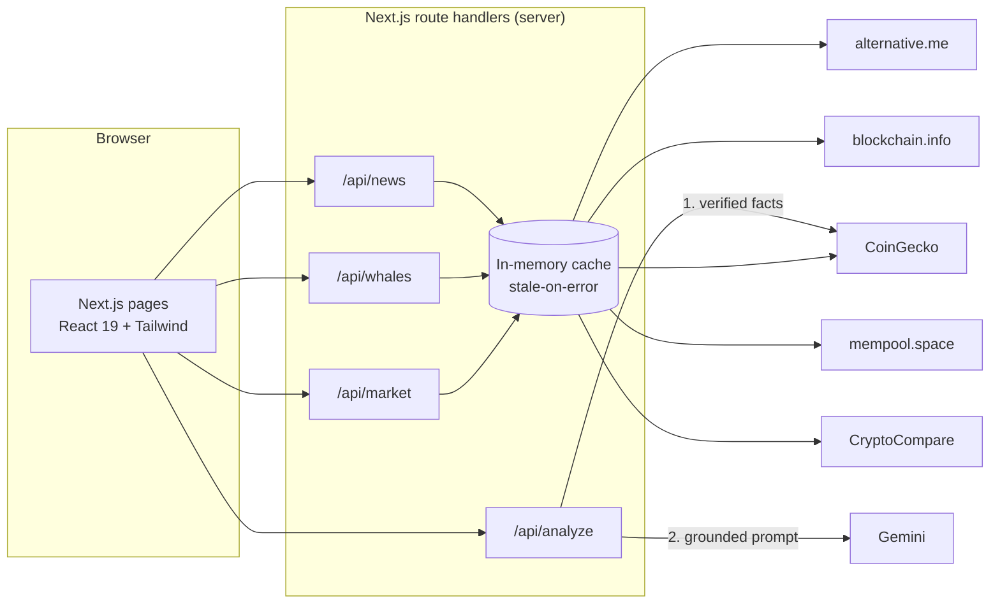

<div align="center">


# 🔍 CryptoLens

### A live crypto market terminal with AI-assisted token research

Real-time prices · Bitcoin whale tracking · Fear & Greed sentiment · AI research reports · Learning academy

<br />

[](https://crypto-lens-zeta.vercel.app/)
[](https://nextjs.org/)
[](https://react.dev/)
[](https://www.typescriptlang.org/)
[](https://tailwindcss.com/)
[](https://ai.google.dev/)
[](LICENSE)

<br />


</div>

> [!WARNING]
> **Research tool only, not financial advice.** Crypto assets are highly volatile and you can lose everything you invest. AI-written text can be wrong or out of date. Always do your own research.

---

## Table of contents

- [Why CryptoLens](#why-cryptolens)
- [Screenshots](#screenshots)
- [Features](#features)
- [Where the data comes from](#where-the-data-comes-from)
- [Architecture](#architecture)
- [Getting started](#getting-started)
- [Deploy to Vercel](#deploy-to-vercel)
- [API reference](#api-reference)
- [Design decisions](#design-decisions)
- [Project structure](#project-structure)
- [Known limitations](#known-limitations)
- [Roadmap](#roadmap)
- [License](#license)

## Why CryptoLens

Most hobby crypto dashboards are mockups with hard-coded numbers. CryptoLens is built the other way round: **every figure on screen comes from a live public source or from your own input**, and the AI report is *grounded* in verified market data instead of free-associating about a coin from memory.

- **No paid keys required** to run the market features. Only the AI report needs a free Gemini key.
- **Resilient by design.** Free APIs fail and rate-limit; CryptoLens caches responses and serves the last good data instead of breaking.
- **Honest about its limits.** Whale amounts, AI output and data gaps are labelled, not hidden.

## Screenshots

<table>
  <tr>
    <td width="50%"><br /><sub><b>AI Analysis</b>: live CoinGecko facts plus a structured Gemini briefing</sub></td>
    <td width="50%"><br /><sub><b>Whale Watch</b>: large unconfirmed Bitcoin transactions and mempool stats</sub></td>
  </tr>
  <tr>
    <td width="50%"><br /><sub><b>Market Pulse</b>: Fear &amp; Greed history, dominance, trending coins, headlines</sub></td>
    <td width="50%"><br /><sub><b>Market Terminal</b>: ticker, interactive chart, global stats, portfolio</sub></td>
  </tr>
</table>

## Features

| | Feature | What it does |
|---|---|---|
| 📈 | **Market terminal** | Scrolling price ticker for the top 10 coins, interactive TradingView chart (BTC, ETH, SOL, BNB, XRP and built-in symbol search), global market cap, volume and dominance |
| 🧠 | **AI token research** | Type any coin name or ticker. CryptoLens fetches verified CoinGecko data, then Gemini writes an overview, fundamentals, market context and risks. Download the result as Markdown |
| 🐋 | **Whale Watch** | Largest unconfirmed Bitcoin transactions with size filters (All, 10, 100, 1,000 BTC), mempool size and recommended fees, each linking to its explorer page |
| 😨 | **Market Pulse** | Fear &amp; Greed gauge with 30-day history chart, BTC/ETH/other dominance, CoinGecko trending coins and the latest crypto headlines |
| 💼 | **Portfolio tracker** | Add holdings and see live value. Stored only in your browser |
| 🎓 | **Academy** | Four short lessons (blockchain, DeFi, security, technical analysis) with completion tracking and XP, saved locally |

## Where the data comes from

| Feature | Source | Cache |
|---|---|---|
| Prices, global stats, trending | [CoinGecko](https://www.coingecko.com/en/api) public API | 60 s to 5 min |
| Fear & Greed index and history | [alternative.me](https://alternative.me/crypto/fear-and-greed-index/) | 5 min |
| Unconfirmed Bitcoin transactions | [blockchain.info](https://www.blockchain.com/explorer/api) | 20 s |
| Mempool and fee estimates | [mempool.space](https://mempool.space/docs/api) | 20 to 30 s |
| Headlines | [CryptoCompare](https://min-api.cryptocompare.com/) news API | 5 min |
| Charts | [TradingView](https://www.tradingview.com/widget/) embedded widget | n/a |
| AI reports | [Google Gemini](https://ai.google.dev/) REST API | per request |
| Portfolio, Academy progress | Your browser (`localStorage`) | n/a |

## Architecture



**Request flow for an AI report:** the browser posts a token name to `/api/analyze`. The server validates it, looks up the coin on CoinGecko, builds a prompt that includes those verified numbers, calls Gemini with the key held server-side, normalizes the JSON reply and returns both the facts and the analysis.

## Getting started

**Requirements:** Node.js 20 or newer.

```bash
git clone https://github.com/Valentina14142000/CryptoLens.git
cd CryptoLens
npm install
cp .env.example .env.local
npm run dev
```

Open <http://localhost:3000>. The market pages work without any keys. For AI Analysis, set a free key from [Google AI Studio](https://aistudio.google.com/apikey) in `.env.local`.

| Variable | Required | Purpose |
|---|---|---|
| `GEMINI_API_KEY` | For AI Analysis | Server-side only; never sent to the browser |
| `COINGECKO_API_KEY` | No | Free demo key for higher CoinGecko rate limits |
| `GEMINI_MODEL` | No | Override the default model (retired models fall back automatically) |

| Script | Purpose |
|---|---|
| `npm run dev` | Development server with hot reload |
| `npm run build` | Production build |
| `npm run start` | Serve the production build |
| `npm run typecheck` | Strict TypeScript check |

## Deploy to Vercel

1. Import the repository at [vercel.com/new](https://vercel.com/new). The Next.js preset is detected automatically.
2. Add `GEMINI_API_KEY` under **Environment Variables** and mark it Sensitive.
3. Click **Deploy**.
4. If visitors are asked to sign in, disable **Settings → Deployment Protection → Vercel Authentication**.

## API reference

All endpoints return JSON and are cached at the edge for a short time.

| Method | Path | Returns |
|---|---|---|
| `GET` | `/api/market` | Top 20 coins, global stats, Fear & Greed (with 30-day history), trending coins |
| `GET` | `/api/whales` | Largest unconfirmed BTC transactions, mempool size, fee estimates |
| `GET` | `/api/news` | Latest headlines |
| `POST` | `/api/analyze` | Verified token facts and an AI report |

```bash
curl -s -X POST https://crypto-lens-zeta.vercel.app//api/analyze \
  -H "content-type: application/json" \
  -d '{"token":"solana"}'
```

```json
{
  "ok": true,
  "model": "gemini-3.8-flash",
  "facts": { "name": "Solana", "symbol": "SOL", "rank": 5, "price": 150.2, "change24h": 2.1 },
  "analysis": {
    "overview": "...",
    "fundamentals": "...",
    "marketContext": "...",
    "riskFactors": "...",
    "conclusion": "... This is not financial advice."
  }
}
```

Errors return `{ "ok": false, "error": "..." }` with status `400` (bad input), `429` (rate limited) or `502` (provider unavailable).

## Design decisions

- **Grounded AI.** The model only gets to describe the numbers it is handed. The prompt forbids price predictions and buy/sell advice, and requires it to say when its background knowledge may be stale or the token was not found.
- **Stale-on-error cache.** Every upstream call goes through a small in-memory cache. If a free API rate-limits or goes down, the last good response is served instead of an error.
- **Secrets stay on the server.** The Gemini and CoinGecko keys are read only inside route handlers. Input to `/api/analyze` is validated and rate limited per IP.
- **Model fallback.** The Gemini client retries with backoff and falls back to alternate models, because model names get retired.
- **Local-first user data.** Portfolio and Academy progress never leave the browser.

## Project structure

```
src/
├── app/
│   ├── page.tsx              Market terminal
│   ├── analyze/              AI token research
│   ├── whale-stream/         Whale Watch
│   ├── sentiment/            Market Pulse
│   ├── academy/              Lessons and progress
│   └── api/                  market, whales, news, analyze route handlers
├── components/               Dashboard widgets, layout shell, shadcn/ui primitives
├── hooks/use-live.ts         Polling hook that shares requests between components
├── lib/
│   ├── data.ts               Fetchers, parsers and stale-on-error cache
│   ├── gemini.ts             Gemini client with retry and model fallback
│   └── types.ts              Types shared by server and client
└── data/lessons.ts           Academy content
```

## Known limitations

- **Whale amounts** are the sum of a transaction's outputs, which can include change returning to the sender. Wallet owners are not identified, and only Bitcoin is covered.
- **Free APIs are rate limited.** Heavy traffic may show slightly stale data. A free `COINGECKO_API_KEY` raises the limit.
- **The cache is per server instance.** On serverless hosting each instance keeps its own.
- **AI output can be wrong.** It is educational, grounded on live numbers, but not a substitute for research.

## Roadmap

- [ ] Price alerts and watchlists
- [ ] Ethereum and Solana large-transfer tracking
- [ ] Persistent accounts for portfolio sync
- [ ] Automated tests and CI

## License

Released under the [MIT License](LICENSE).

<div align="center"><sub>Built for research and learning. Not financial advice.</sub></div>
